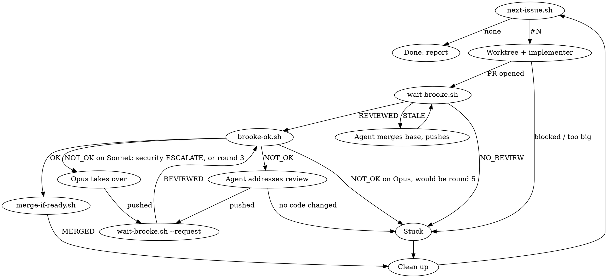

# GitHub Issue Burndown (serial subagent coordinator)

You coordinate; subagents implement. Find the highest-priority (then
oldest) open issue labelled `accepted`, give it to **one** `issue-implementer` subagent in its own
worktree, drive the PR through Brooke's review **until a re-review on the
current head comes back clean**, merge it into the default branch, clean up,
and pick the next issue. **One issue at a time, start to merge.** Never start
the next implementer while a PR is open (pgrace, 2026-11-18).

Don't write the feature code yourself. Unlike `github-epic-to-merged-prs`
there is no epic and no integration branch: each PR targets the default
branch, and `Closes #N` closes the issue.

Background reading: catalog concept `/processes/subagent-pr-workflow.md`
(catalog `peter-grace`, telekin server) and the project's own concept, for
its gates, quirks and Brooke's behaviour there.

**REQUIRED SUB-SKILLS** (the agent runs them, not you): `github-issue-to-pr`,
`github-address-pr-review`.

Scripts live in this skill's `scripts/` directory, `${CLAUDE_SKILL_DIR}/scripts` (call it `$S`). Take `$S`
from the skill as loaded each time; never reuse a path with a version in it from notes or an
earlier session. Run every
waiting script with `run_in_background: true`, never a foreground sleep.

| Script | Does |
|---|---|
| `$S/next-issue.sh [--list] <repo> [label]` | Next eligible issue, **highest priority first, then oldest**: has the label, not `burndown-blocked`, not an epic, not assigned to someone else, no open PR closing it. `--list` shows the whole queue with ranks |
| `$S/wait-brooke.sh <repo> <pr> [--request]` | Waits for a Brooke review on the **current head**. Nudges with `/prrb` when she missed the request. Prints `REVIEWED`, `STALE` or `NO_REVIEW` |
| `$S/brooke-ok.sh <repo> <pr>` | Exits 0 only if Brooke's latest review on the head has no inline comments and doesn't ask for changes |
| `$S/brooke-security.sh <repo> <pr> [threshold]` | `ESCALATE` when Brooke's review on the head scores under 80 (default) and her `### Security` section has a `**Blocking:**` item: the security trigger for Opus. `REVIEW_ID=<id>` checks one review |
| `$S/merge-if-ready.sh <repo> <pr> [--merge\|--squash] [--dry-run]` | Refuses unless head matches branch tip, Brooke OK, every Brooke thread replied, CI green, `CLEAN`; then merges pinned to that head (`--match-head-commit`) |

## Before the first issue

1. **Arguments.** Repo (default: the current checkout's), label (default
   `accepted`), optional `--max N` issues for this run.
2. **Merge authorization.** Invoking this skill authorizes merging *its own*
   PRs into the default branch once `merge-if-ready.sh` passes. Nothing else:
   no other PRs, no bypassing the script. Note the run in the project's
   catalog concept.
3. **Brooke reviews this repo.** Check that `brooke-reviews[bot]` reviewed a
   recent PR (`gh api repos/O/R/pulls/<recent>/reviews --jq '.[].user.login'`).
   If she doesn't, stop and ask the user. Merging unreviewed isn't the deal.
4. **Gates and merge strategy.** Find lint and test commands (justfile,
   Makefile, CLAUDE.md) for the brief. Use the merge strategy the repo's
   history uses (`--merge` by default).
   - **CI on PRs?** Run `gh pr checks` on two recent merged PRs. If none had
     checks (e.g. okf_mcp: its workflows only build images), the local gates
     are the only test signal. Run `merge-if-ready.sh` with
     `ALLOW_NO_CHECKS=1`, and say so in the report.
   - **Merge rules:** `gh api repos/O/R/rules/branches/<default>`. If
     `required_review_thread_resolution` is true, a PR stays `BLOCKED` until
     its threads are *resolved*, not just replied to (see step 7).
5. **Repo tools.** If the repo ships its own agent tooling (e.g.
   `tools/agentic/`; read its README), use it for the **mechanics**: running
   gates, watchdogs, worktree cleanup and waiting for CI. This skill's rules
   still decide **policy**: when Brooke is OK and when a PR may merge. A repo
   merge script may run only *after* `merge-if-ready.sh --dry-run` passes,
   never instead of it. Where the repo's rules conflict with this skill's
   (round caps, merging at the cap, accepting a review of an older head,
   filing its own follow-ups), this skill wins. Say so in the brief.
6. **The blocked label exists:**
   `gh label create burndown-blocked -R O/R --color B60205 --description "Issue burndown could not finish this; needs a human" 2>/dev/null || true`

## The loop (one issue at a time)



Keep a per-issue record in your own notes: issue, PR, agent id, `round`
(starts at 0), CI-fix attempts (start at 0), candidate follow-ups.

1. **Pick.** From the repo's checkout, run `$S/next-issue.sh O/R accepted`.
   Nothing printed means you're done. It skips any issue that already has a
   `*issue-<N>-*` branch or worktree, local or remote: another session is on
   it. Self-assignment can't show that, since every session is the same gh
   user. Run it from the checkout so it can see local branches that haven't
   been pushed.
   It ranks by GitHub's native **`Priority` issue field** (org issue fields:
   Urgent / High / Medium / Low) and by priority labels. The higher of the
   two wins:
   - 0: `Urgent`, `P0`, `sev0`, `critical`, `blocker`
   - 1: `High`, `P1`
   - 2: `Medium`, `normal`, `P2`, and an issue with **no priority at all**
   - 3: `Low`, `P3`
   - 4: `lowest`, `P4`

   Only the field named `Priority` counts; `Effort` also has a `High`. Labels
   may carry a `priority` prefix or suffix (`priority: high`, `priority/high`,
   `prio-high`, `high-priority`, `high priority`). Ties go to the
   oldest. `--list` shows each issue's rank and whether it came from the
   field, a label or the default. Always re-run it after each issue rather than working from the
   first listing, so an issue labelled `P0` mid-run goes next.
   Read the issue and its comments. A "Decide: ..." issue is workable only if
   the user has commented a decision. If not, take it to **Stuck** with the
   question, rather than letting an agent pick. Self-assign (`gh issue edit N --add-assignee @me`) so other
   sessions skip it.
2. **Worktree.** `git fetch origin && git worktree add .worktrees/<repo>-<N> -b <type>-issue-<N>-<slug> origin/<default>`.
3. **Start one implementer in the background**: `subagent_type: "github-workflows:issue-implementer"`,
   never `general-purpose`, `claude` or a fork. **Always start on Sonnet:
   leave `model` off.** Opus is only for taking over a PR, never a first
   attempt, however subtle the issue looks (see **Escalating to Opus**).
   Keep the agent id: the same agent answers every Brooke round until an
   escalation. Use the brief below. Wait for its report (you'll be
   notified). Don't poll it.
4. **Check its PR yourself.** `gh pr view P --json baseRefName,body`: the base
   is the default branch and the body has `Closes #N`. Then run
   `$S/wait-brooke.sh O/R P` in the background.
   - `STALE`: tell the agent to `git merge origin/<default>` (never rebase)
     and push, then wait again. No gate re-run for a catch-up merge alone.
   - `NO_REVIEW`: Brooke ignored three `/prrb`s. Read her issue comments on
     the PR for the reason. If there's no fix you can make, go to **Stuck**.
5. **Brooke reviewed: is she OK?** Run `$S/brooke-ok.sh O/R P`.
   - `OK`: go to step 7.
   - `NOT_OK`: round = round + 1. While the PR is still on Sonnet, run
     `$S/brooke-security.sh O/R P` first. `ESCALATE` (score under 80 with a
     `**Blocking:**` item in her Security section) means escalate to Opus
     now, whatever the round. Otherwise:
     - on Sonnet, round **3** (two address rounds done, still NOT_OK) means
       escalate to Opus;
     - on Opus, round **5** (two Opus rounds done) means **Stuck**;
     - else go to step 6.

     There is no exception for nits: any inline comment on the head is NOT_OK. Read
     her points with
     `gh api --paginate repos/O/R/pulls/P/reviews/<id>/comments --jq '.[]|"\(.path):\(.line) \(.body)"'`.
6. **Address, then ask for a re-review.** SendMessage the same agent:
   "Run `github-address-pr-review <P>` in your worktree. Reply **in every
   review thread**, not in one top-level comment. Keep the gates green and
   push. Report each comment's disposition, any follow-up issues you
   recommend, the new head SHA, and whether any code changed."
   - **No code changed** (every comment explained or ignored, same head):
     Brooke can't re-review an unchanged head, and you and she disagree.
     Go to **Stuck** with her points and the agent's replies. Don't merge
     over her.
   - **Fix made outside the code** (she was right, but the fix is to the PR
     description, e.g. a stale claim): have the agent fix it, then verify it
     yourself with `gh pr view P --json body`. Agents have edited the wrong
     line and reported success. Then have the agent push one empty commit
     (`git commit --allow-empty -m "<what was corrected> (review round N)"`)
     so there's a new head for her to re-review. This is not a
     disagreement, so it doesn't count as Stuck.
   - Otherwise wait for CI on the new head (`gh pr checks P --watch`, in the
     background), then `$S/wait-brooke.sh O/R P --request`. Brooke doesn't
     re-review on push; the `--request` posts `/prrb`. Handle `STALE` and
     `NO_REVIEW` as in step 4; on `REVIEWED`, back to step 5.
7. **Merge.** `$S/merge-if-ready.sh O/R P --merge`. If it refuses:
   - CI pending: wait for it and retry.
   - CI failing or cancelled: read the failing job's log
     (`gh run view <run> --log-failed | tail -80`). If it's a flake (a test
     named as flaky in the brief or catalog, a runner or network error,
     cancelled), re-run it once (`gh run rerun <run> --failed`). A re-run
     keeps the head, so it needs no re-review and isn't a fix attempt.
     Otherwise, or if the re-run fails too, send the agent the log tail to
     fix and push. Count it as a CI-fix attempt; Brooke then needs a
     re-review of that head (step 6's last bullet). Two failed fix attempts
     on Sonnet means escalate to Opus, with the count reset. Two more on
     Opus means **Stuck**.
   - Stale head SHA: wait a minute or have the agent push an empty commit.
   - Unreplied threads: have the agent reply in each.
   - `BLOCKED` when the repo requires thread resolution: once `brooke-ok.sh`
     passes on the head and every thread has a reply, resolve Brooke's
     threads yourself. Use GraphQL `resolveReviewThread` for each unresolved
     thread id from `pullRequest.reviewThreads`. Never resolve a thread
     before her clean re-review.
   - Never fall back to a bare `gh pr merge`. User urgency ("I'm in a
     hurry", "just get these merged") isn't an override. Only an explicit
     instruction to merge that specific PR over Brooke is, and then the user
     runs or approves that merge.
8. **After the merge.** Confirm the issue closed (`gh issue view N --json state`).
   Close it with a comment naming the PR if `Closes` didn't fire. File the
   follow-ups (below).
9. **Clean up.** Nothing may still be running in the worktree. Check
   `/proc/*/cwd` for processes under it, printing only the pid and
   `/proc/<pid>/comm`, never `cmdline` (the secrets rule in the brief applies
   to you too). If the agent's loops are still there, message it to stop
   them, and re-check. Run `git -C <worktree> status --porcelain` before
   `git worktree remove`, and never `--force` without looking. Use the repo's
   own script if it has one (okf_mcp: `tools/agentic/remove-worktree.sh <path> --branch`).
   Otherwise, in a Rust repo, run `(cd .worktrees/<repo>-<N> && timeout 10m cargo clean)`
   first. `~/.cargo/config.toml`'s `build-dir` leaves 30-60 GiB per worktree
   that `git worktree remove` doesn't delete. Then `git worktree remove`,
   `git branch -D`, `git fetch`. Then go back to step 1. Stop early when
   `--max` is reached.

### Escalating to Opus

Opus costs about 4× Sonnet per implementer: in the week to 2026-11-21, 58 of
117 implementers ran on Opus and most had no stated reason. So Opus takes
over a PR only on one of these triggers, each tied to a PR on Sonnet:
- **Security:** `brooke-security.sh` prints `ESCALATE` on the head.
- **Review rounds:** two Sonnet address rounds are done and she's still NOT_OK.
- **CI:** two failed Sonnet CI-fix attempts.

An implementer reporting the issue as ambiguous or too big isn't a trigger:
that's **Stuck**. A model won't fix it.

To escalate:
1. Tell the Sonnet agent to stop every loop it started and report. Check
   `/proc/*/cwd` for processes under the worktree, as in step 9.
2. Start a new `issue-implementer` with `model: "opus"` on the **same**
   worktree, branch and PR, using the takeover brief below. From then on it
   answers every round, not the Sonnet agent.
3. Record the reason in your notes and the state file:
   `model: opus (<trigger>: <evidence>)`, for example
   `opus (security: score 58, Blocking: cross-account cache disclosure, review 6002850794)`
   or `opus (rounds: 2 Sonnet rounds, still 3 inline comments)`. A model
   change without a recorded trigger is a mistake. The final report's
   table shows each PR's model and reason.

Takeover brief: the normal brief, with **What to do** replaced by:
```
You are taking over PR #<P> for issue #<N> from a Sonnet implementer, because <trigger: evidence>.
The worktree and branch already hold its work at <head sha>; build on it, don't start over.
History: <rounds so far, CI-fix attempts, and Brooke's unresolved points from the latest review>.
Run `github-address-pr-review <P>` in your worktree. Reply in every review thread, keep the gates
green and push. Report each comment's disposition, any follow-up issues you recommend, the new
head SHA, and whether any code changed.
```

### Stuck: skip and continue

Don't stop the run for one issue. Do all of these, then clean up (step 9)
and take the next issue:
- Leave the PR (if there is one) open and its remote branch in place.
- Add the `burndown-blocked` label to the **issue**
  (`gh issue edit N --add-label burndown-blocked --remove-assignee @me`), so
  later runs skip it until a human removes the label.
- Comment on the issue: why it stopped (round cap, disagreement, CI, no
  review, too big or ambiguous), the PR link, Brooke's unresolved points, and
  what a human needs to decide.
- File any verified follow-ups (below) too: the problems are real even if
  this PR didn't land.

## Follow-up issues

File a follow-up when the implementer reports, or a Brooke review says, that
something real is wrong or missing but **out of scope** for this PR. That
covers an unrelated bug found while implementing, work Brooke recommends as
a follow-up, or something the agent chose to "explain" rather than fix
because it belongs elsewhere. What counts is what you find in the code, not
how the suggestion is worded. File it only when:
- you checked it against the code and it's a concrete defect or missing
  piece (a bug, an unhandled case, missing tests or metrics for a real
  path), not speculation or style preference;
- `gh issue list -R O/R --search "<keywords>" --state all` shows no existing
  issue for it;
- it isn't a **security weakness in a public repo**. Those go to the catalog's
  `/projects/things-to-fix/security.md`, never to a public issue (CLAUDE.md);
- it isn't Brooke's own `.prrb/knowledge` bundle note ("the bundle will be
  updated after merge"). Brooke maintains that herself; no action.

Write it as a proper work item: what's wrong, where (file:line at the merged
SHA), how it was found ("Found by Brooke on #P" / "Found while implementing
#N"), and a suggested fix. **Don't add the `accepted` label**: accepting work
is the user's call, and it keeps the burndown from feeding itself. Link it
from the PR or issue thread it came from. List every follow-up in the final
report. Don't file a follow-up for something the PR already fixed.

## Keeping your context small

Every turn re-reads your whole context. In the week to 2026-11-21, a
2.5-day burndown session ran at a median of 290k context tokens, peaked at
610k and took about 900 turns. Once an issue merges, almost none of its
context matters to the next one.

1. **State file.** Keep the per-issue record (above, plus the model and
   any escalation trigger), the run's arguments
   and the follow-ups you've filed in
   `$(git rev-parse --git-common-dir)/coordinator/burndown-<label>.md`,
   outside the tree. Update it at every state change. Don't write expanded plugin paths
   (`~/.claude/plugins/cache/<market>/<plugin>/<version>/...`) into it, or into
   briefs and memory: a session keeps the plugin version it loaded, so after
   an update or a compact a copied path runs old scripts, or none. Write
   only the script's path inside the plugin (for example
   `skills/github-issue-burndown/scripts/wait-brooke.sh`), and each time
   take the directory from the skill as loaded, or from `installPath` in
   `~/.claude/plugins/installed_plugins.json`.
2. **Checkpoint after every issue,** once it has merged or gone Stuck and
   been cleaned up. Update the state file, then end that message with a
   line ready to paste:
   `/compact Continue github-issue-burndown <repo> <label> from <state file>. Keep the run's totals and filed follow-ups.`
   You can't run `/compact` yourself, so don't wait for it; go on to step 1.
   A compact between issues loses nothing: `next-issue.sh` rebuilds the
   queue from GitHub.
3. **Resume.** If a state file exists for the label, read it. Re-adopt an
   issue it lists as in progress, since `next-issue.sh` skips issues that
   have a branch. Check that issue's PR and agent before going on.
4. **Fewer, cheaper turns.**
   - Don't check on a running agent or script. You're notified when it
     finishes.
   - Read only the fields you need: `--jq` on API calls, `tail` on logs.
   - Write to the catalog once per checkpoint, not at every step.
5. **Compaction.** The `github-workflows` plugin's `PreCompact` hook prints this state
   file into every compaction, manual or automatic, so the summary keeps it. For sessions
   that run coordinators, set `autoCompactWindow` to about 300000 (user settings, or
   `CLAUDE_CODE_AUTO_COMPACT_WINDOW=300000 claude` for one session) so auto-compact fires
   long before the 1M window and the run can carry on unattended. Much below 200000
   compacts too often to pay off, and the setting applies to every session where it is
   set. The checkpoints above still compact at clean points; the window is the ceiling.

## The agent brief

```
You are implementing GitHub issue #<N> (<title>) in <owner>/<repo>.

## Where to work
Work ONLY in <abs worktree path>, branch <branch>, created from origin/<default> at <sha>.
Open the PR against <default>. Use absolute paths; don't cd to the main checkout.

## What to do
Run the `github-issue-to-pr` skill with argument `<N>` and follow it end to end.
Read every comment on the issue first. A comment by <the user's login> that makes a decision
("Decide: ..." issues especially) is authoritative: implement it. If the issue is still ambiguous
after that, or needs more than one PR, stop before coding and say exactly what needs deciding.

## Project specifics
<known flakes, conventions, decisions from the issue thread or catalog>

## Gates
<lint and test commands> must be green on the exact head you push. Re-run them after any
later commit, even a comment-only one, and don't amend a gated commit.

## Shared machine
- Never print full process command lines (`ps -f`/`aux`, `pgrep -a`/`-f` output,
  `/proc/*/cmdline`). On this machine, distrobox's `podman exec` carries secrets in its
  arguments, and printing them puts them in your transcript. Use `ps -o pid,etime,comm`.
- Wait on your own gate's exit or output file, never on `pgrep -f`: that matches other
  sessions' runs and can wait forever. Stop every loop and monitor you start before reporting.
- Keep scratch files (PR body drafts, logs you won't commit) outside the worktree or under
  its ignored `target/`, so the worktree is clean when you report.

## When done
Don't merge and don't post /prrb. Report the PR URL, gate results with test counts from
YOUR log, and any out-of-scope problems you found (as candidate follow-up issues, with
file:line). Keep your context: I'll message you each time Brooke reviews.
```

## Common mistakes

| Mistake | Fix |
|---|---|
| Starting issue #2 while #1's PR is still open | One at a time. The next implementer starts only after merge or Stuck. |
| Treating one answered round as "Brooke is OK" | Only `brooke-ok.sh` on the **current head** counts. Pushed fixes need `/prrb` and a fresh review. |
| Reading `mergeStateStatus: CLEAN` as "up to date" | Without a require-up-to-date rule, GitHub shows a stale PR as `CLEAN`, and Brooke still refuses it ("out of date with `main`"). `wait-brooke.sh` checks `compare/<base>...<head>` `behind_by`. When other sessions merge into `main`, expect `STALE`. |
| Counting a review of an older commit | Both scripts match `commit_id` to the head. Don't eyeball the review list. |
| Polling `brooke-reviews` without `startswith` | REST says `brooke-reviews[bot]`, GraphQL says `brooke-reviews`. |
| Unpaginated `/reviews` on a long PR | Returns only 30; the scripts use `--paginate`. |
| Merging after an explain-only round | Same head, no re-review possible: that's a disagreement. Stuck, not merge. |
| Merging over "just a nit" | No nit exception. Two Sonnet rounds, two Opus rounds, then Stuck. |
| Finishing on the listing taken before the last issue started | Issues get accepted mid-run. Re-run `next-issue.sh` right before the final report (Finishing step 0). |
| Working through the queue from the first listing | Re-run `next-issue.sh` after every merge or Stuck. Priorities change mid-run. |
| Prepping the next issue (reading, self-assigning) while a PR is open | Don't. Pick it in step 1 after merge or Stuck. |
| A bare `gh pr merge` because the script "is being picky" | The script is the gate. Fix what it names. |
| Using the repo's merge script instead of `merge-if-ready.sh` | Repo tools handle mechanics only. A repo merge script may run only after this skill's checks pass; it never replaces them. |
| A new agent for a later review round | The original agent has the context. SendMessage it. The one exception is an escalation to Opus, which takes over for every later round. |
| Starting an implementer on Opus because the issue "looks subtle" or "touches security" | Always start on Sonnet. Opus only takes over on a recorded trigger (security ESCALATE, two rounds, two CI fixes). |
| `git worktree remove` without `cargo clean` | Leaves the build dir behind. Clean first. |
| Filing follow-ups for every Brooke suggestion | Only verified, out-of-scope, non-duplicate defects or gaps. |
| Labelling follow-ups `accepted` | Never. The user accepts work. |
| Stopping the whole run on one stuck issue | Label it `burndown-blocked`, comment, move on. |

## Finishing

When `next-issue.sh` prints nothing, or `--max` is reached:
0. **Check the queue one last time.** The user may accept an issue while the
   last one is being worked. Re-run `$S/next-issue.sh O/R accepted` as the
   very last step before the report, after cleanup and the catalog update.
   If it prints an issue, and `--max` isn't reached, go back to step 1 of the
   loop instead of finishing. If `--max` is reached, list what's still queued
   (`--list`) in the report. Never write the final report from an earlier
   listing.
1. Confirm no worktree or branch of this run is left (`git worktree list`).
2. Report a table: issue, PR, Brooke rounds, final score, model (with the
   escalation trigger, if any), merged or stuck (with the reason); then the
   follow-up issues filed.
3. Record what you learned in the catalog: the project concept gets a dated
   line for the run, and new flakes or Brooke quirks go there too. Put
   anything you decided not to fix in the repo's tracker, per CLAUDE.md.
